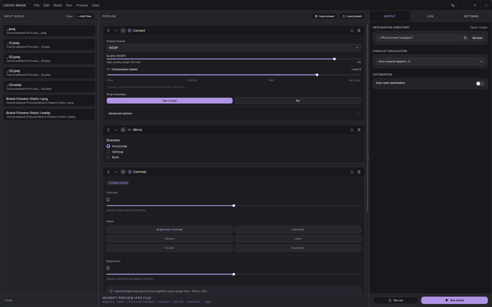
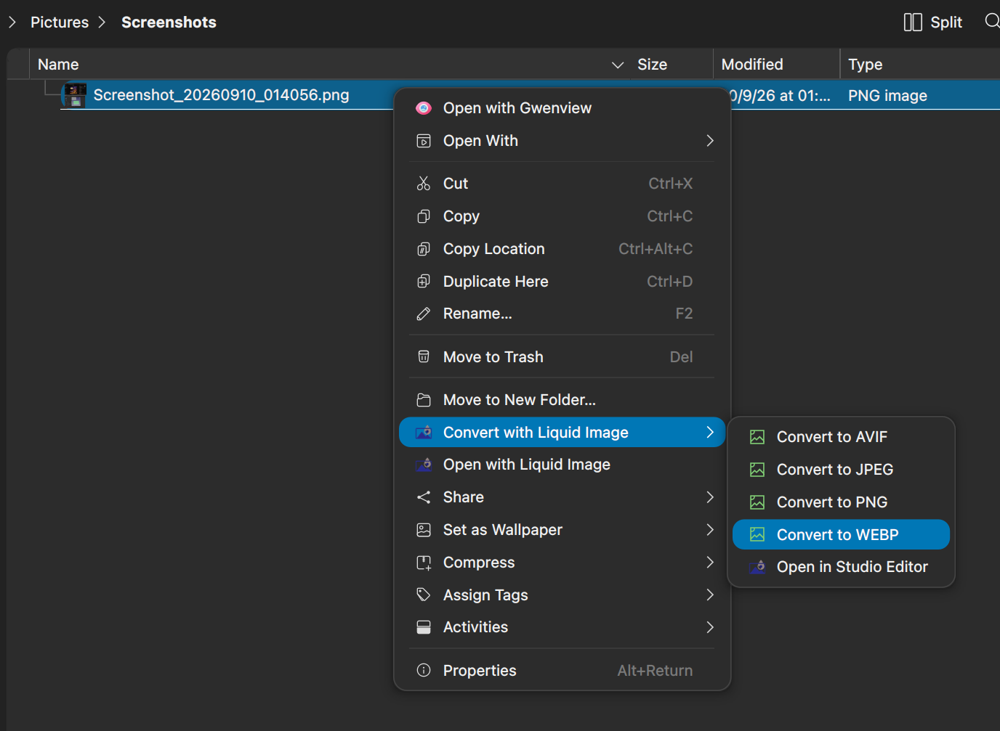
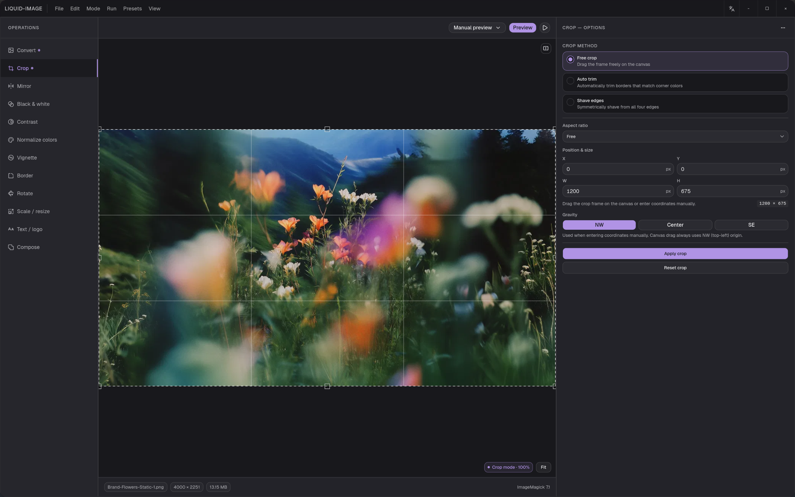
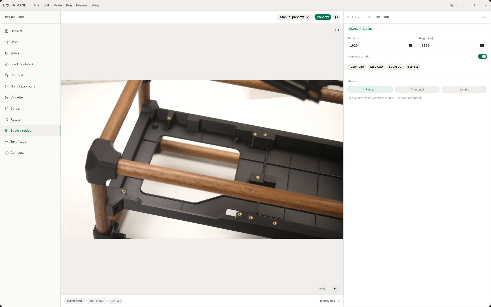
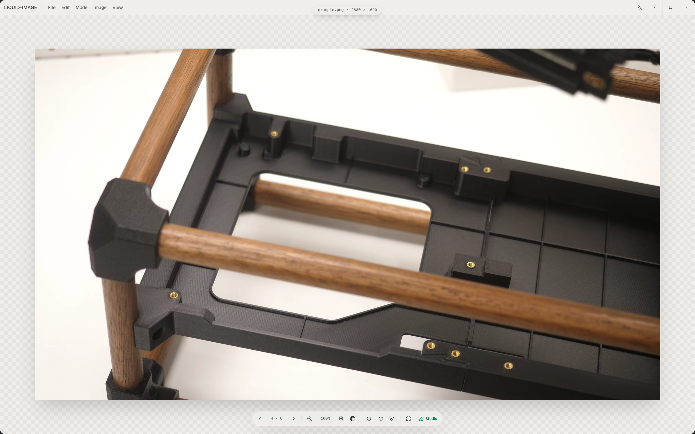
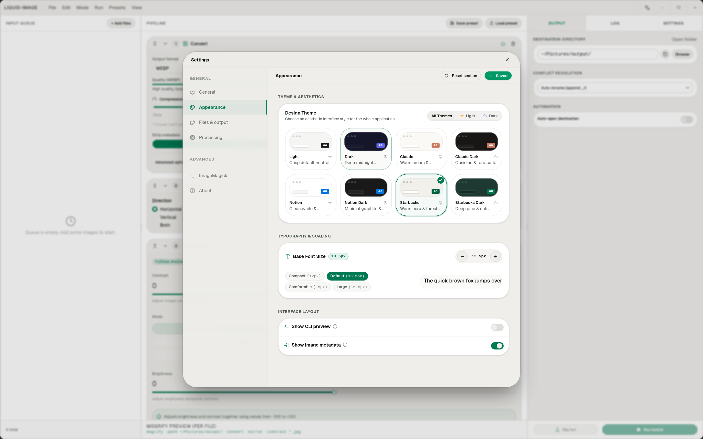

<p align="center">
  
</p>

<h1 align="center">Liquid Image</h1>

<p align="center">
  <b>A modern, high-performance desktop batch image processor and converter.</b><br>
  Build a pipeline once, run it on hundreds of files: convert, crop, resize, adjust, watermark and more,<br>
  powered by <b>ImageMagick</b> and <b>Tauri v2</b>. Native, offline, and fast.
</p>

<p align="center">
  
  
  
  
  
  <br>
  <a href="https://github.com/huybach1609/liquid-image/releases"></a>
  <a href="https://github.com/huybach1609/liquid-image/stargazers"></a>
  <a href="LICENSE"></a>
</p>

<p align="center">
  <a href="https://github.com/huybach1609/liquid-image/releases"></a>
</p>

<br>

<p align="center">
  
  <br>
  <sub>Batch mode: queue files, stack operations into a pipeline, and see the generated <code>mogrify</code> command live.</sub>
</p>

<p align="center">
  <a href="#features">Features</a> ·
  <a href="#operations">Operations</a> ·
  <a href="#installation--setup">Installation</a> ·
  <a href="#configuring-imagemagick-in-app">Configuration</a> ·
  <a href="#development">Development</a>
</p>

<br>

<table>
  <tr>
    <td width="25%" valign="top">
      <h3>📦 Batch first</h3>
      Drop in a folder of images, build a pipeline, hit <b>Run batch</b>. Dry run first if you want to be sure.
    </td>
    <td width="25%" valign="top">
      <h3>⚡ Native and fast</h3>
      A Rust backend on Tauri v2 driving ImageMagick 7 directly. Small binary, low memory, no browser tab.
    </td>
    <td width="25%" valign="top">
      <h3>🎛️ Visual editing</h3>
      Edit mode shows a live preview on the canvas, with drag-to-crop and a before/after split.
    </td>
    <td width="25%" valign="top">
      <h3>🎨 Made to fit you</h3>
      8 built-in themes in light and dark, adjustable font size, and a multilingual UI.
    </td>
  </tr>
</table>

<br>

## Features

<table>
  <tr>
    <td width="55%" valign="middle">
      
      <br>
      <sub>Right-click any image in Dolphin to convert it without opening the app.</sub>
    </td>
    <td width="45%" valign="middle">
      <h3>⚡ Convert straight from your file manager</h3>
      Right-click one or more images and choose <b>Convert with Liquid Image › Convert to AVIF / JPEG / PNG / WEBP</b>. No window, no pipeline to set up, just a converted file next to the original.
      <br><br>
      Need more control? <b>Open in Studio Editor</b> sends the image straight into Edit mode, and <b>Open with Liquid Image</b> opens it in the built-in viewer.
      <br><br>
      Works in <b>Windows File Explorer</b> and <b>KDE Dolphin</b>. Turn it on and choose which formats to show in <b>Settings › Files &amp; output › File Explorer &amp; Context Menu</b>.
    </td>
  </tr>
</table>

<table>
  <tr>
    <td width="50%" valign="top">
      
      <br>
      <sub>Free crop with a rule-of-thirds grid, aspect ratio and gravity controls.</sub>
      <h3>Edit with a live preview</h3>
      Switch to <b>Edit mode</b> to tune one operation at a time on a real image. Drag the crop frame on the canvas or enter exact coordinates, then preview before you apply.
      <br><br>
      Crop methods include <b>Free crop</b>, <b>Auto trim</b> (removes borders that match the corner colours) and <b>Shave edges</b>.
    </td>
    <td width="50%" valign="top">
      
      <br>
      <sub>Scale / resize with size presets and a choice of resampling method.</sub>
      <h3>Precise, predictable resizing</h3>
      Set width and height, lock the aspect ratio, or pick a preset (1920×1080, 1280×720, 800×600, 512×512).
      <br><br>
      Choose <b>Resize</b> for high-quality filtered output, <b>Thumbnail</b> for small, metadata-free previews, or <b>Sample</b> for speed.
    </td>
  </tr>
  <tr>
    <td width="50%" valign="top">
      
      <br>
      <sub>The built-in viewer, with zoom, rotate, fullscreen and a one-click jump to Studio.</sub>
      <h3>A viewer built in</h3>
      Open any image to browse through the folder, zoom, fit, rotate and go fullscreen. When something needs fixing, press <b>Studio</b> to open it straight into the editor.
    </td>
    <td width="50%" valign="top">
      
      <br>
      <sub>Settings › Appearance: themes, base font size and layout options.</sub>
      <h3>Make it yours</h3>
      Pick from <b>Light, Dark, Claude, Claude Dark, Notion, Notion Dark, Starbucks</b> and <b>Starbucks Dark</b>. Scale the interface from Compact to Large, and toggle the CLI preview or image metadata.
    </td>
  </tr>
</table>

<br>

## Operations

<table>
  <tr>
    <td width="33%" valign="top">
      <h4>🖼️ Format &amp; geometry</h4>
      Convert · Crop · Mirror · Rotate · Scale / resize · Border
    </td>
    <td width="33%" valign="top">
      <h4>🎨 Colour &amp; tone</h4>
      Black &amp; white · Contrast (Brightness/Contrast, Sigmoidal, Stretch, Level, CLAHE, Normalize) · Normalize colors · Vignette
    </td>
    <td width="33%" valign="top">
      <h4>✍️ Overlay &amp; compose</h4>
      Text / logo watermarks · Compose
    </td>
  </tr>
</table>

Convert supports output format, quality, compression speed and metadata stripping. Pipelines can be reordered by drag and drop, toggled per step, and saved or loaded as **presets**.

<br>

---

## Installation & Setup

### Windows

Liquid Image comes with ImageMagick **pre-bundled** on Windows. **No additional installation or setup is required for most users.**

1. Download the latest Windows installer (`.exe` or `.msi`) from [Releases](https://github.com/huybach1609/liquid-image/releases).
2. Run the installer and launch **Liquid Image**.
3. *(Optional)* If prompted by Windows for missing runtime components on clean Windows installations, install the [Microsoft Visual C++ 2015–2022 Redistributable (x64)](https://aka.ms/vs/17/release/vc_redist.x64.exe).

#### Using System ImageMagick on Windows (Optional)
If you wish to use an external or newer version of ImageMagick (e.g., with Ghostscript support for PDF/EPS files):
- Install via Windows Package Manager:
  ```powershell
  winget install ImageMagick.ImageMagick
  ```
- Or download the installer from [imagemagick.org](https://imagemagick.org/script/download.php#windows) and ensure you check **"Add application directory to your system path"**.
- In Liquid Image, go to **Settings > ImageMagick** and select or browse to your custom binary path.

---

### macOS

On macOS, Liquid Image uses your system's ImageMagick installation via [Homebrew](https://brew.sh/).

#### Step 1: Install ImageMagick
Open Terminal and run:
```bash
brew install imagemagick
```

*(Optional: If you need support for PDF, AI, or EPS documents, also install Ghostscript)*:
```bash
brew install ghostscript
```

#### Step 2: Install Liquid Image
1. Download `liquid-image.dmg` from [Releases](https://github.com/huybach1609/liquid-image/releases).
2. Open the DMG file and drag **Liquid Image** into your **Applications** folder.
3. Launch the application. Liquid Image will automatically detect your Homebrew installation (`/opt/homebrew/bin/magick` on Apple Silicon or `/usr/local/bin/magick` on Intel Macs).

> [!TIP]
> **Troubleshooting on macOS:**
> If ImageMagick is not detected automatically, navigate to **Settings > ImageMagick**, click **Browse** (press `Cmd + Shift + G` in the file picker dialog) and specify `/opt/homebrew/bin/magick` (Apple Silicon) or `/usr/local/bin/magick` (Intel).

---

### Linux

#### Arch Linux / Arch-based distributions (CachyOS, Manjaro, EndeavourOS)

You can install `liquid-image` using `makepkg` without needing the AUR. Choose one of the two options below:

##### Option 1: Fast installation from pre-compiled binary (`liquid-image-bin`, Recommended)
Installs in seconds. No need to install `rust`, `cargo`, or `bun`.

```bash
git clone https://github.com/huybach1609/liquid-image.git
cd liquid-image/packaging/liquid-image-bin
makepkg -si
```

##### Option 2: Compile from source (`liquid-image`)
Builds and compiles the source code locally on your machine. Requires `rust`, `cargo`, and `bun` installed.

```bash
git clone https://github.com/huybach1609/liquid-image.git
cd liquid-image/packaging/liquid-image
makepkg -si
```

##### Updating
To update to a newer release in the future:

```bash
git pull
# Run makepkg -sif in your preferred directory (packaging/liquid-image-bin or packaging/liquid-image)
makepkg -sif
```

##### Uninstalling
Since both packages register with `pacman`, remove them anytime with:

```bash
sudo pacman -R liquid-image
```

---

#### Other Linux Distributions

##### Step 1: Install ImageMagick
Liquid Image includes a Linux sidecar binary, but you can also use your system package manager for optimal performance and format support:

- **Ubuntu / Debian:**
  ```bash
  sudo apt update && sudo apt install -y imagemagick
  ```
- **Fedora:**
  ```bash
  sudo dnf install -y ImageMagick
  ```

##### Step 2: Install Liquid Image
Download the `.deb`, `.AppImage`, or package from [Releases](https://github.com/huybach1609/liquid-image/releases).


---

## Configuring ImageMagick in App

Liquid Image provides built-in configuration under **Settings > ImageMagick**:

- **Bundled / Sidecar:** Uses the executable packaged directly within Liquid Image (default on Windows).
- **Custom / System:** Enter or browse to a specific ImageMagick binary path. Click **Test** to verify that the version string and capabilities are recognized before saving.

---

## Development

### Prerequisites

- [Bun](https://bun.sh/)
- [Rust](https://www.rust-lang.org/) (stable toolchain)
- Platform-specific Tauri dependencies: [Tauri Prerequisites](https://v2.tauri.app/start/prerequisites/)

### Running Locally

```bash
# Install dependencies
bun install

# Start Vite frontend and Tauri desktop window
bun run tauri dev
```

### Building for Production

```bash
bun run tauri build
```

---

## License

Liquid Image is released under the [MIT License](LICENSE).
It bundles [ImageMagick](https://imagemagick.org), which is distributed under its own license. See [THIRD_PARTY_NOTICES.md](THIRD_PARTY_NOTICES.md).
